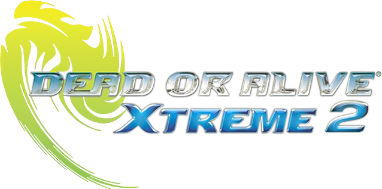

<p align="center">
  
</p>

# DOAX2 Recomp

We need testers! Please try DX12 or Vulkan, and simply upload your run logs as an issue to contribute to the project.
> A native Windows PC port of **Dead or Alive Xtreme 2** (Xbox 360), built with
the [ReXGlue SDK](https://github.com/rexglue/rexglue-sdk) static
recompiler. The game's PowerPC code is translated ahead of time into C++ and
runs natively, at 30 FPS or at a native 60 FPS with the original game speed.

> [!WARNING]
> Intel integrated graphics now work with the **DX12 (Native)** renderer. On
> Intel Iris Xe, **Vulkan (Native)** crashes at the title screen, so use DX12
> (Native) there. Dedicated graphics cards by Intel have not been tested;
> expect issues on these. The system requirements below are also estimates.
> Feel free to try running the game on low-end hardware.

> **This repository and its releases do not contain the game.** No game code,
> data, audio or video is included. You need your own copy of Dead or Alive
> Xtreme 2 for the Xbox 360. Please do not share or link to game files in
> issues or pull requests. The launcher uses a fan-made project logo; its
> background shows a Dead or Alive character, who belongs to Koei Tecmo and
> is not covered by this project's license. The logo at the top of this page
> is the game's logo; it also belongs to Koei Tecmo and is not covered by this
> project's license.
>
> Not affiliated with or endorsed by Koei Tecmo, Team NINJA or Microsoft.
> All trademarks belong to their respective owners.

Current version: **1.1.8** (see [CHANGELOG.md](CHANGELOG.md)).

## Supported game version

Only the retail disc version is supported:

| | |
|---|---|
| Title ID | `544307D2` |
| Media ID | `21B9628E` |
| `default.xex` version | `3` (base version `3`), XEX2 |
| `default.xex` SHA-256 | `c4a14853e1f7af951be34f380604113703638780b36d5e74e674fe7431992870` |

Title updates are not supported.

## Playing (release build)

1. Download the latest `DOAX2-Recomp-v<version>-win64.zip` from the
   [Releases](../../releases) page and extract it anywhere.
2. Extract your Xbox 360 disc (for example with `extract-xiso`) into the
   folder `extracted game files here`, so that `default.xex` sits directly
   inside it.
3. Run `DOAX2 Recomp Launcher.exe`, choose 30 or 60 FPS and press **PLAY**.
   **Settings** and **Graphics Settings** hold the other options, each with
   an explanation. **Input** sets the keyboard keys and player 1's
   controller buttons (experimental). **Update** installs the newest
   release (see [Updating](#updating)).

Saves are written to the `userdata` folder next to the launcher. Every time the launcher
opens it copies `userdata` to a `save-backup` folder, replacing the previous
backup.

## Renderers

Choose the renderer under **Renderer** on the launcher's **Graphics Settings**
page. Since v1.1.6 the native renderers draw the game's render passes the way
the game describes them, instead of emulating the Xbox 360's graphics chip and
its 10 MB of fast video memory (EDRAM). This should help lower-end systems run
the game, such as PCs with GTX 900 and 1000 series graphics cards.

| Renderer | Use it for |
|---|---|
| **Vulkan (Native)** | Recommended first: the lowest GPU load, to target higher FPS. New and still experimental. Screen copies go straight into the textures that use them. |
| **DX12 (Native)** | The default, and the one to use on Intel integrated graphics. Draws each 3D scene once, with much lower CPU load than Emulated. |
| **Emulated** | The original, slowest path. Use it if something looks wrong on both native renderers, and please report it. |

If one native renderer does not work well on your PC, try the other: each is a
fallback for the other. **We need testers for Vulkan (Native):** please
[open an issue](../../issues) with how it runs, your graphics card, your
settings and the FPS you get.

In tests at 4K on an RTX 3090, DX12 (Native) cut GPU time at the pool from 14.0
to 8.4 ms per frame, and Vulkan (Native) took the swimsuit menu from 39 to a
locked 60 FPS.

Frame pacing follows your display: when its refresh rate is a multiple of the
game's frame rate (60, 120, 180, 240 Hz and up), every frame lands on its own
refresh. Other refresh rates, and G-SYNC / FreeSync, use a precise timer.

## Updating

From v1.1.3 on, the launcher can update itself:

1. Press **Update** on the launcher's main screen. It checks GitHub for the
   latest release and shows your version and the newest one.
2. If a newer version is available, press **Install Update**. Progress bars
   show each step: the download, a SHA-256 check against the release's
   `SHA256SUMS.txt`, unpacking and installing.
3. Press **Restart Launcher** when it is done.

Updating keeps your saves (`userdata`), your settings (`config`) and your
game files (`extracted game files here`). If a file cannot be replaced, the
update stops and your previous version is restored. Close the game before
updating. The launcher only goes online while the Update page is open.

Versions before v1.1.3 have no Update page: download the new release zip
and extract it over your existing folder (or copy your `userdata` and
`config` folders into the new one).

## Controls

Xbox, PlayStation, Switch and most other controllers work. The game reads
buttons by their position, so the bottom face button (Xbox A, PlayStation
Cross, Switch B) confirms.

The keyboard also works as a controller, together with a connected pad.
Default keys:

| Controller | Key |
| --- | --- |
| Start / Back | Enter / Tab |
| A / B / X / Y | Space / Backspace / F / R |
| LB / RB / LT / RT | Q / E / Z / C |
| Left stick (click) | W A S D (V) |
| Right stick (click) | I J K L (H) |
| D-pad | Arrow keys |

The launcher's **Input** page (experimental) changes them: the Keyboard tab
sets two keys for every controller input, and the Controller tab remaps
player 1's controller buttons, triggers and stick directions. Each tab has
**Reset to Defaults**.

## Network access

The game does not use the internet or your local network. Since v1.1.2
every network call is blocked, so the game never opens a network port and
Windows Firewall has nothing to ask about.

The only exception is the launcher's **Update** page (since v1.1.3). Only
while you open it, it asks GitHub for the latest release, and **Install
Update** downloads it, checks its SHA-256 checksum and replaces the program
files. Your saves, settings and game files are kept. Nothing about you or
your PC is sent.

Before v1.1.2, Windows could show a firewall prompt for `doax2.exe`. The
original Xbox 360 game prepares a System Link port (UDP 1000) when it
starts, and that made Windows ask. Nothing was ever sent or downloaded, and
it was safe to block. Developers can read [docs/NETWORK.md](docs/NETWORK.md)
for the details and for how to turn networking back on.

## System requirements

The game is rendered on the GPU through Direct3D 12 or Vulkan (see
[Renderers](#renderers)), so the graphics card matters most. Targets are 60 FPS
with Resolution Scale at 1x.

These figures were measured before the native renderers, with what is now the
Emulated renderer. The native renderers need less, so lower-end cards than the
ones listed may run the game well. New figures will follow as results come in.

| | 1080p: Minimum | 1080p: Recommended | 1440p: Minimum | 1440p: Recommended |
|---|---|---|---|---|
| **Graphics card** | NVIDIA RTX 2060 Super / RTX 3060<br>AMD RX 6600 XT | NVIDIA RTX 3060 Ti / RTX 4060 Ti<br>AMD RX 6700 XT | NVIDIA RTX 3060 Ti / RTX 4060 Ti<br>AMD RX 6700 XT | NVIDIA RTX 4070 / RTX 3080<br>AMD RX 6800 / RX 7800 XT |
| **Processor** | Intel Core i5-10400<br>AMD Ryzen 5 3600 | Intel Core i5-12400<br>AMD Ryzen 5 5600X | Intel Core i5-12400<br>AMD Ryzen 5 5600X | Intel Core i5-12600K<br>AMD Ryzen 7 5800X3D |
| **Memory** | 8 GB | 16 GB | 16 GB | 16 GB |

All configurations: Windows 10 or 11 (64-bit), a graphics card with DirectX 12
or Vulkan support and up-to-date drivers, and about 7 GB of free space (the extracted game is
about 6.2 GB, the release about 55 MB).

For **4K at 60 FPS**, plan on an NVIDIA RTX 4080 or AMD RX 7900 XTX class card.

### Tested results (Emulated renderer)

| System | 1080p | 1440p | 4K |
|---|---|---|---|
| RTX 2060 Super + Core i5-12600K | 60 FPS | ~45 FPS | |
| RX 6950 XT | | 60 FPS | ~50 FPS |
| RTX 3090 | | 60 FPS | ~50 FPS |

The other cards in the table are placed by their typical performance relative
to these tested cards: about 1.35x an RTX 2060 Super for 1440p at 60 FPS, and
about 1.2x an RX 6950 XT / RTX 3090 for 4K. The processor and memory
recommendations are estimates. Raising Resolution Scale above 1x needs a much
faster graphics card. Results from other hardware are welcome in the issues.

## Building from source

See [docs/BUILDING.md](docs/BUILDING.md). In short:

```powershell
git clone --recurse-submodules <this repository>
cd DOAX2-Recomp
.\scripts\setup-sdk.ps1        # SDK submodule + this project's SDK patch + SDK build
# put your extracted game files in .\game (default.xex directly inside)
.\scripts\generate-code.ps1    # recompile default.xex into generated/ (never committed)
.\scripts\configure-game.ps1
cmake --build out\game
```

## Repository layout

| Path | Contents |
|---|---|
| `src/` | Port code: `main.cpp`, the 60 FPS / timing hooks (`doax2_60fps.cpp`), the release launcher (`launcher_public.cpp`) and the developer launcher (`launcher.cpp`) |
| `resources/launcher/` | Launcher art (background, fan-made logo, icon) embedded into the launcher |
| `resources/readme/` | The game logo shown at the top of this page |
| `config/`, `doax2_manifest.toml` | ReXGlue code generation manifest (function boundaries, fibers) |
| `patches/rexglue-sdk/` | This project's changes to ReXGlue SDK v0.10.0 (native renderers, renderer fixes, title music player) |
| `sdk/rexglue-sdk/` | ReXGlue SDK v0.10.0 (git submodule) |
| `android/` | Android app sources (in development, not part of the Windows release) |
| `scripts/` | Setup, code generation, build, release packaging and analysis helpers |
| `tests/`, `tools/` | Host-side tests and small developer utilities |
| `docs/` | Build and release guides; `docs/notes/` holds engineering notes from development |
| `game/` | Your extracted game files go here (ignored by git) |

## Branches

- **`main`**: development. Fork this to make changes.
- **`release`**: the code that release builds are made from. Approved changes
  are merged from `main`, then a release is built with
  `scripts/build-release.ps1` and published on the Releases page (see
  [docs/RELEASING.md](docs/RELEASING.md)).

## License

The port's own code is BSD 3-Clause (see [LICENSE](LICENSE)); it covers only
material owned by the project's contributors and grants no rights to the
game. Third-party components keep their own licenses, listed in
[THIRD-PARTY-NOTICES.md](THIRD-PARTY-NOTICES.md).
