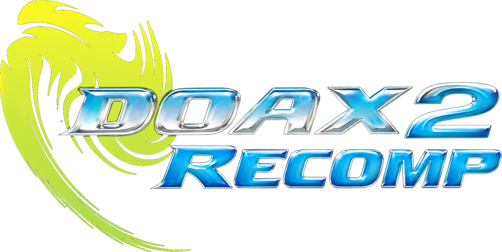

<p align="center">
  
</p>

# DOAX2 Recomp

A native Windows PC port of **Dead or Alive Xtreme 2** (Xbox 360), built with
the [ReXGlue SDK](https://github.com/rexglue/rexglue-sdk) static
recompiler. The game's PowerPC code is translated ahead of time into C++ and
runs natively, at 30 FPS or at a native 60 FPS with the original game speed.

> [!WARNING]
> At the moment, Intel integrated graphics are not supported. Dedicated
> graphics cards by Intel have not been tested; expect issues on these. The
> system requirements below are also estimates. Feel free to try running the
> game on low-end hardware.

> **This repository and its releases do not contain the game.** No game code,
> data, audio or video is included. You need your own copy of Dead or Alive
> Xtreme 2 for the Xbox 360. Please do not share or link to game files in
> issues or pull requests. The launcher uses a fan-made project logo; its
> background shows a Dead or Alive character, who belongs to Koei Tecmo and
> is not covered by this project's license.
>
> Not affiliated with or endorsed by Koei Tecmo, Team NINJA or Microsoft.
> All trademarks belong to their respective owners.

Current version: **1.1** (see [CHANGELOG.md](CHANGELOG.md)).

## Supported game version

Only the retail disc version is supported:

| | |
|---|---|
| Title ID | `544307D2` |
| Media ID | `21B9628E` |
| `default.xex` version | `3` (base version `3`), XEX2 |
| `default.xex` SHA-256 | `c4a14853e1f7af951be34f380604113703638780b36d5e74e674fe7431992870` |

Title updates are not supported.

## Playing (release build)

1. Download the latest `DOAX2-Recomp-v<version>-win64.zip` from the
   [Releases](../../releases) page and extract it anywhere.
2. Extract your Xbox 360 disc (for example with `extract-xiso`) into the
   folder `extracted game files here`, so that `default.xex` sits directly
   inside it.
3. Run `DOAX2 Recomp Launcher.exe`, choose 30 or 60 FPS and press **PLAY**.
   **Settings** and **Graphics Settings** hold the other options, each with
   an explanation.

Saves are written to the `userdata` folder next to the launcher.

## System requirements

The game is rendered on the GPU through Direct3D 12, emulating the Xbox 360's
graphics chip, so the graphics card matters most. Targets are 60 FPS with
Resolution Scale at 1x.

| | 1080p: Minimum | 1080p: Recommended | 1440p: Minimum | 1440p: Recommended |
|---|---|---|---|---|
| **Graphics card** | NVIDIA RTX 2060 Super / RTX 3060<br>AMD RX 6600 XT | NVIDIA RTX 3060 Ti / RTX 4060 Ti<br>AMD RX 6700 XT | NVIDIA RTX 3060 Ti / RTX 4060 Ti<br>AMD RX 6700 XT | NVIDIA RTX 4070 / RTX 3080<br>AMD RX 6800 / RX 7800 XT |
| **Processor** | Intel Core i5-10400<br>AMD Ryzen 5 3600 | Intel Core i5-12400<br>AMD Ryzen 5 5600X | Intel Core i5-12400<br>AMD Ryzen 5 5600X | Intel Core i5-12600K<br>AMD Ryzen 7 5800X3D |
| **Memory** | 8 GB | 16 GB | 16 GB | 16 GB |

All configurations: Windows 10 or 11 (64-bit), a DirectX 12 graphics card
with up-to-date drivers, and about 7 GB of free space (the extracted game is
about 6.2 GB, the release about 55 MB).

For **4K at 60 FPS**, plan on an NVIDIA RTX 4080 or AMD RX 7900 XTX class card.

### Tested results

| System | 1080p | 1440p | 4K |
|---|---|---|---|
| RTX 2060 Super + Core i5-12600K | 60 FPS | ~45 FPS | |
| RX 6950 XT | | 60 FPS | ~50 FPS |
| RTX 3090 | | 60 FPS | ~50 FPS |

The other cards in the table are placed by their typical performance relative
to these tested cards: about 1.35x an RTX 2060 Super for 1440p at 60 FPS, and
about 1.2x an RX 6950 XT / RTX 3090 for 4K. The processor and memory
recommendations are estimates. Raising Resolution Scale above 1x needs a much
faster graphics card. Results from other hardware are welcome in the issues.

## Building from source

See [docs/BUILDING.md](docs/BUILDING.md). In short:

```powershell
git clone --recurse-submodules <this repository>
cd DOAX2-Recomp
.\scripts\setup-sdk.ps1        # SDK submodule + this project's SDK patch + SDK build
# put your extracted game files in .\game (default.xex directly inside)
.\scripts\generate-code.ps1    # recompile default.xex into generated/ (never committed)
.\scripts\configure-game.ps1
cmake --build out\game
```

## Repository layout

| Path | Contents |
|---|---|
| `src/` | Port code: `main.cpp`, the 60 FPS / timing hooks (`doax2_60fps.cpp`), the release launcher (`launcher_public.cpp`) and the developer launcher (`launcher.cpp`) |
| `resources/launcher/` | Launcher art (background, fan-made logo, icon) embedded into the launcher |
| `config/`, `doax2_manifest.toml` | ReXGlue code generation manifest (function boundaries, fibers) |
| `patches/rexglue-sdk/` | This project's changes to ReXGlue SDK v0.10.0 (renderer fixes, title music player) |
| `sdk/rexglue-sdk/` | ReXGlue SDK v0.10.0 (git submodule) |
| `scripts/` | Setup, code generation, build, release packaging and analysis helpers |
| `tests/`, `tools/` | Host-side tests and small developer utilities |
| `docs/` | Build and release guides; `docs/notes/` holds engineering notes from development |
| `game/` | Your extracted game files go here (ignored by git) |

## Branches

- **`main`**: development. Fork this to make changes.
- **`release`**: the code that release builds are made from. Approved changes
  are merged from `main`, then a release is built with
  `scripts/build-release.ps1` and published on the Releases page (see
  [docs/RELEASING.md](docs/RELEASING.md)).

## License

The port's own code is BSD 3-Clause (see [LICENSE](LICENSE)); it covers only
material owned by the project's contributors and grants no rights to the
game. Third-party components keep their own licenses, listed in
[THIRD-PARTY-NOTICES.md](THIRD-PARTY-NOTICES.md).
